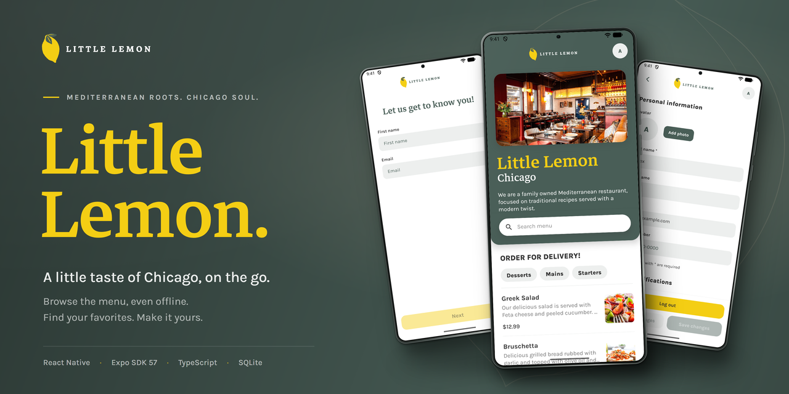

# Little Lemon



<p align="center">
  
  
  
  
</p>

A little taste of Chicago, on the go. Little Lemon is an Android and iOS
restaurant app built for Meta’s React Native capstone. Create a local profile,
explore a Mediterranean menu, and find dishes with search and category filters.

[Demo](#demo) · [Features](#features) · [Run locally](#run-locally) ·
[How it works](#how-it-works) · [Design](#design) · [Project structure](#project-structure)

## Demo

<p align="center">
  <a href="https://github.com/user-attachments/assets/da45e53e-2734-4f33-ab44-f59d9393b2c7">
    
  </a>
  <br>
  <sub>Tap the preview to watch the full walkthrough.</sub>
</p>

[Watch the video](https://github.com/user-attachments/assets/da45e53e-2734-4f33-ab44-f59d9393b2c7)
· [Download the MP4](docs/demo.mp4)

<details>
<summary>View the three screens</summary>

<table>
  <tr>
    <th>Onboarding</th>
    <th>Menu</th>
    <th>Profile</th>
  </tr>
  <tr>
    <td></td>
    <td></td>
    <td></td>
  </tr>
</table>

</details>

## Features

- **Simple onboarding.** Validates the first name and email, saves the profile
  on the device, and remembers whether onboarding is complete.
- **A scrollable restaurant menu.** The hero collapses as you scroll, keeping
  search visible. Focusing search brings it above the keyboard.
- **Search powered by SQLite.** Dish names use a case-insensitive substring
  match with a 500 ms debounce. Category selections combine with the name
  query, so every result satisfies both filters.
- **Menu data available offline.** After the first successful download, dish
  details and categories are read from the local database. Failed dish images
  show an accessible placeholder.
- **An editable profile.** Add or change a photo, update personal details,
  and save email-notification preferences. Phone input formats as you type.
- **Explicit save and discard.** Edits stay in a draft until saved, with toast
  feedback for success and errors. Logging out clears the local profile and
  attempts to remove its saved photo.

This is a course project for menu browsing and local profile management.
Onboarding does not create a server account; notification options are stored
preferences. Ordering, payments, and email delivery are outside the current scope.

## Run locally

### Requirements

- Node.js **22.13 or newer** and npm, following the
  [Expo SDK 57 requirements](https://docs.expo.dev/versions/v57.0.0/).
- Expo Go compatible with SDK 57 on a physical Android or iOS device, or a
  configured Android emulator / iOS simulator.
- An internet connection for the first menu download.

From the repository root:

```sh
npm ci
npm start
```

Scan the QR code with Expo Go, or press `a` for Android or `i` for the
iOS simulator. The iOS simulator requires macOS and Xcode. On a physical
device, keep your phone and computer on the same network.

No API keys, environment variables, or backend setup are required.

### Commands

| Command | Purpose |
| --- | --- |
| `npm start` | Start the Expo development server |
| `npm run android` | Start Expo and open Android |
| `npm run ios` | Start Expo and open the iOS simulator |
| `npm run lint` | Check the code with ESLint |
| `npx tsc --noEmit` | Check TypeScript types |

The primary targets are Android and iOS. A `web` script is included, but
browser support needs the additional
[Expo SQLite web configuration](https://docs.expo.dev/versions/v57.0.0/sdk/sqlite/#web-setup).

## How it works

### Menu data and filtering

On first use, the app downloads the
[Meta course menu](https://raw.githubusercontent.com/Meta-Mobile-Developer-PC/Working-With-Data-API/main/capstone.json)
and inserts its dishes into SQLite in a transaction. Subsequent launches use
the populated cache.

The screen passes search text and selected categories to
[`useMenu`](src/hooks/use-menu.ts). The hook debounces text changes and calls
[`queryMenu`](src/data/menu-database.ts), which builds a parameterized SQL
query. Filtering happens in the database.

For example, searching for `Gr` and selecting `mains` produces a query
equivalent to:

```sql
SELECT id, name, price, description, category, imageUrl
FROM menu
WHERE name LIKE ? COLLATE NOCASE
  AND category IN (?)
ORDER BY id;
```

Bound values are `["%Gr%", "mains"]`. A dish must match the name and belong
to a selected category. With multiple categories, any selected category
matches; with no active filters, every dish is returned.

Category changes query immediately using the current debounced search text.
The 500 ms delay applies only to text input.

### Local state

| Data | Storage | Behavior |
| --- | --- | --- |
| Dish details and categories | SQLite | Downloaded when the menu table is empty |
| Profile and notification preferences | AsyncStorage | Restored on launch and updated on save |
| Saved profile photo | App document storage | Copied from the picker when profile changes are saved |
| Unsaved profile edits | React state | Saved explicitly or discarded |

Expo Router’s protected routes use the restored onboarding state to choose
between onboarding and the home/profile screens.

Dish images remain remote URLs; they are not downloaded into the SQLite
cache. Offline image availability depends on the image cache, and a fallback
appears when loading fails. The menu cache currently has no automatic refresh.
Logging out clears profile state while retaining the cached menu.

## Design

The interface follows the Little Lemon palette, with **Markazi Text** for
display titles and **Karla** for body text and controls. Shared colors,
typography, spacing, sizing, and shadows live in
[`theme.ts`](src/constants/theme.ts).

<table>
  <tr>
    <th>Primary green</th>
    <th>Primary yellow</th>
    <th>Coral</th>
    <th>Peach</th>
    <th>Light</th>
    <th>Dark</th>
    <th>White</th>
  </tr>
  <tr>
    <td align="center"><br><code>#495E57</code></td>
    <td align="center"><br><code>#F4CE14</code></td>
    <td align="center"><br><code>#EE9972</code></td>
    <td align="center"><br><code>#FBDABB</code></td>
    <td align="center"><br><code>#EDEFEE</code></td>
    <td align="center"><br><code>#333333</code></td>
    <td align="center"><br><code>#FFFFFF</code></td>
  </tr>
</table>

Screens compose shared headers, buttons, form fields, avatars, and toasts.
Each component owns its markup and a private `styles.ts` file.

<details>
<summary>View the annotated Figma wireframe</summary>

The home screen is organized around four areas: navigation, the restaurant
hero and search, category filters, and the menu list.


</details>

The repository banner is generated from an editable
[HTML template](docs/social-preview.html) using the original screenshots and
bundled brand fonts.

## Tech stack

| Area | Tools |
| --- | --- |
| App framework | Expo SDK 57, React Native 0.86, React 19.2, TypeScript 6 |
| Navigation | Expo Router with protected routes |
| Menu persistence | `expo-sqlite` |
| Profile persistence | `@react-native-async-storage/async-storage` |
| Animation and scrolling | Reanimated 4, Worklets, `react-native-sticky-parallax-header` |
| Photos | `expo-image-picker`, `expo-file-system` |
| Fonts, icons, and inputs | `expo-font`, `@react-native-vector-icons/material-icons`, `react-native-mask-text` |

Exact versions are recorded in [package.json](package.json) and
[package-lock.json](package-lock.json).

## Project structure

```text
src/
├── app/         Expo Router routes and root providers
├── screens/     Onboarding, homepage, and profile
├── components/  Shared UI and component styles
├── hooks/       Menu state, debounce, and scroll elevation
├── data/        SQLite schema, menu download, and queries
├── context/     Profile and onboarding state
├── constants/   Design tokens
├── types/       Shared TypeScript types
└── utils/       Validation and profile helpers
assets/          Bundled fonts and images
docs/            Demo, screenshots, wireframe, and banner
```

Start with [the root layout](src/app/_layout.tsx) for app initialization,
[the homepage](src/screens/homepage/homepage.tsx) for menu composition, or
[the menu database module](src/data/menu-database.ts) for persistence and queries.

## Acknowledgements

Built as the capstone project for Meta’s React Native course on Coursera,
using the Little Lemon design brief and the Meta course menu API.
