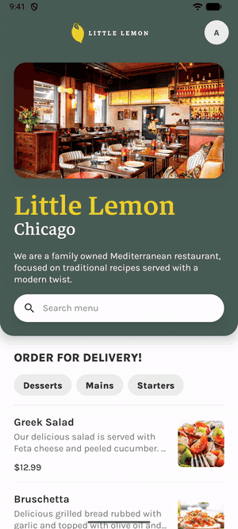
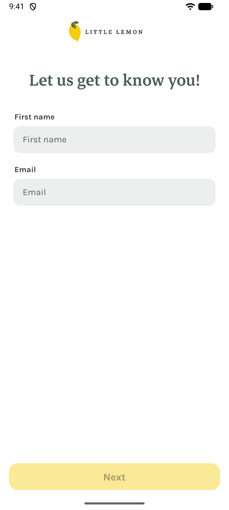
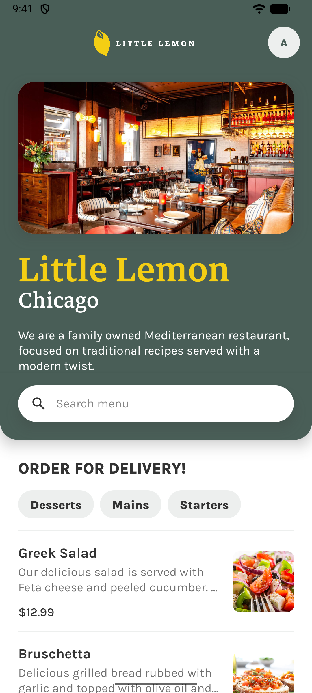
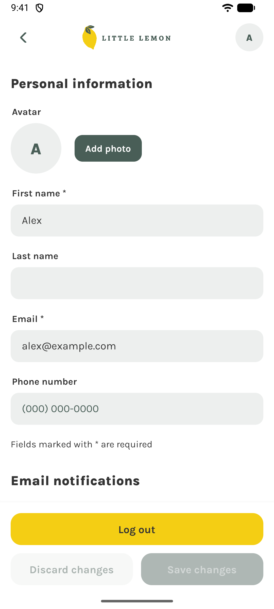
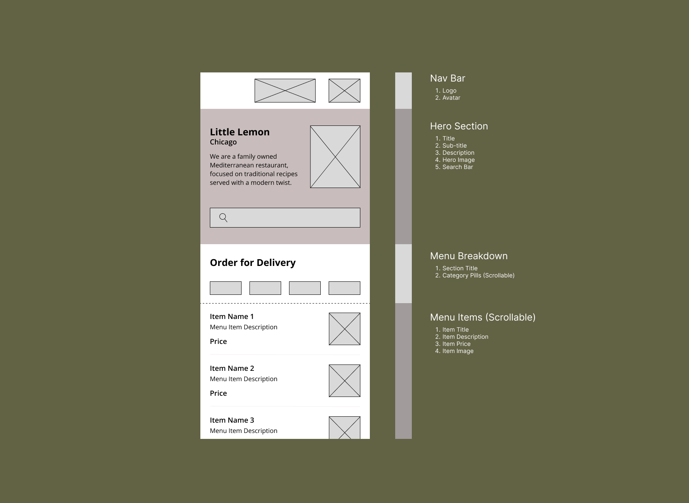

# Little Lemon


Little Lemon is the mobile app for a family-owned Mediterranean restaurant in
Chicago. New customers sign up with their name and email, browse and search
the menu, and manage their profile and email preferences. It runs on Android
and iOS and is built with Expo Router, React Native, and TypeScript.

## Demo

<p align="center">
  <a href="https://github.com/user-attachments/assets/da45e53e-2734-4f33-ab44-f59d9393b2c7">
    
  </a>
  <br>
  <sub>Tap the preview to watch the full walkthrough (1:15)</sub>
</p>


## Screenshots

<table>
  <tr>
    <th>Onboarding</th>
    <th>Home</th>
    <th>Profile</th>
  </tr>
  <tr>
    <td></td>
    <td></td>
    <td></td>
  </tr>
</table>

## Wireframe

The home screen was designed in Figma before implementation. The wireframe
breaks it into four parts: the nav bar, the hero with its search bar, the
category filters, and the scrollable menu.



## Features

### Onboarding

- Asks for a first name and an email. **Next** stays disabled until the name
  contains only letters, spaces, apostrophes, or hyphens and the email is
  valid.
- Saves the profile on the device. Routes are protected, so the home and
  profile screens only open after onboarding, and onboarding only shows when
  signed out.

### Home

- The hero collapses as you scroll and the search bar stays pinned under the
  header.
- The menu is downloaded once and cached in SQLite, so it works offline after
  the first launch.
- Search by dish name and filter by one or more categories. Both filters
  combine in a single SQLite query, and search waits 500 ms after you stop
  typing.
- Dishes whose image fails to load show a placeholder icon.

### Profile

- Pick a profile photo from the gallery, crop it square, and remove it later.
  The photo is copied into app storage and appears in the header of the home
  and profile screens.
- Edit first name, last name, email, and a phone number that formats itself
  as you type. Required fields are marked with `*`.
- Choose which email notifications you get.
- Changes stay as a draft until **Save changes**. **Discard changes** restores
  the saved profile, and a toast confirms each save.
- **Log out** deletes the stored profile and photo and returns to onboarding.

## Design system

The UI follows the Little Lemon brand guide. Colors, fonts, spacing, sizes,
and shadows are defined once in [`src/constants/theme.ts`](src/constants/theme.ts),
and screens are built from shared components in
[`src/components`](src/components).

| Preview | Color | Hex |
| --- | --- | --- |
|  | Primary green | `#495E57` |
|  | Primary yellow | `#F4CE14` |
|  | Coral | `#EE9972` |
|  | Peach | `#FBDABB` |
|  | Light | `#EDEFEE` |
|  | Dark | `#333333` |
|  | White | `#FFFFFF` |

Titles use **Markazi Text**. Body text, labels, and buttons use **Karla**.

## Tech stack

| Area | Libraries |
| --- | --- |
| Framework | Expo SDK 57, React Native 0.86, React 19, TypeScript |
| Navigation | Expo Router (file-based, protected routes) |
| Menu cache | `expo-sqlite` |
| Profile storage | `@react-native-async-storage/async-storage` |
| Profile photos | `expo-image-picker`, `expo-file-system` |
| UI | `react-native-sticky-parallax-header`, `react-native-mask-text`, `@react-native-vector-icons/material-icons`, `expo-font` |

## Getting started

You need Node.js and npm, plus either the Expo Go app (SDK 57) on a phone or
an Android emulator or iOS simulator.

```sh
npm install
npm start
```

Then press `a` for Android, `i` for iOS, or scan the QR code with Expo Go.

| Command | What it does |
| --- | --- |
| `npm start` | Starts the Expo dev server |
| `npm run android` | Starts the dev server and opens Android |
| `npm run ios` | Starts the dev server and opens iOS |
| `npm run lint` | Runs ESLint |
| `npx tsc --noEmit` | Type-checks the project |

## Project structure

```text
src/
├── app/         Expo Router routes and the root layout
├── screens/     Onboarding, home, and profile screens
├── components/  Shared UI (Header, AppButton, FormField, Toast, …)
├── hooks/       useMenu, useScrollElevation, useDebouncedValue
├── data/        SQLite schema, menu download, and queries
├── context/     Profile and onboarding state
├── constants/   Design tokens (theme.ts)
├── types/       Shared types
└── utils/       Validation and helpers
assets/          Fonts and images
docs/            README media
```

## Data

The menu comes from the
[Meta course menu API](https://raw.githubusercontent.com/Meta-Mobile-Developer-PC/Working-With-Data-API/main/capstone.json).
The Lemon Dessert image is missing from that server, so the app shows its
placeholder icon for that dish.

## Acknowledgements

Built as the capstone project for Meta's React Native course on Coursera.
